<picture>
  <source media="(prefers-color-scheme: dark) and (max-width: 640px)" srcset="assets/card-dark-m.svg">
  <source media="(max-width: 640px)" srcset="assets/card-light-m.svg">
  <source media="(prefers-color-scheme: dark)" srcset="assets/card-dark.svg">
  
</picture>

<picture>
  <source media="(max-width: 640px)" srcset="assets/terminal-m.svg">
  
</picture>

<a href="https://younesberiane.github.io">younesberiane.github.io</a>

  <picture>
    <source media="(prefers-color-scheme: dark)" srcset="https://streak-stats.demolab.com?user=drakeo338&hide_border=true&background=00000000&ring=7dd3fc&fire=7dd3fc&currStreakNum=e5edf7&sideNums=e5edf7&currStreakLabel=8fd3ff&sideLabels=97a5ba&dates=76849c&stroke=1e293b">
    
  </picture>

  <picture>
    <source media="(prefers-color-scheme: dark)" srcset="https://skillicons.dev/icons?i=py%2Cts%2Cjs%2Crust%2Cgo%2Cbash&theme=dark">
    
  </picture>

### Merged upstream

<!-- merged:start -->
| Project | Stars | Fix |
|---|--:|---|
| [openclaw/openclaw #161454](https://github.com/openclaw/openclaw/pull/161454) | 392.7k | Pass the responding agent to summary model acquisition |
| [affaan-m/ECC #3267](https://github.com/affaan-m/ECC/pull/3267) | 285.8k | Honor CLAUDE_CONFIG_DIR for the default agent data home |
| [affaan-m/ECC #3525](https://github.com/affaan-m/ECC/pull/3525) | 285.8k | Raise on unparseable skill-comply classifier output |
| [nextlevelbuilder/ui-ux-pro-max-skill #526](https://github.com/nextlevelbuilder/ui-ux-pro-max-skill/pull/526) | 138.6k | Keep icon generator from corrupting SVGs or truncating output |
| [harry0703/MoneyPrinterTurbo #1585](https://github.com/harry0703/MoneyPrinterTurbo/pull/1585) | 133.8k | Require --video-materials for the local video source |
| [mrdoob/three.js #34729](https://github.com/mrdoob/three.js/pull/34729) | 116.7k | WebGLBackend: Fix clear() with a disabled color write mask. |
| [thedotmack/claude-mem #4767](https://github.com/thedotmack/claude-mem/pull/4767) | 102.2k | Show help for install, update, uninstall and other action verbs instead of running them |
| [thedotmack/claude-mem #4879](https://github.com/thedotmack/claude-mem/pull/4879) | 102.2k | Skip V2 setup when the context has no checkout directory |
| [mui/material-ui #49481](https://github.com/mui/material-ui/pull/49481) | 99.3k | [material-ui] Fix `theme.vars` types for zIndex, opacity and action opacities |
| [tailwindlabs/tailwindcss #20569](https://github.com/tailwindlabs/tailwindcss/pull/20569) | 98k | Use `margin-trim: block` in the `@property` fallback detection |
| [unclecode/crawl4ai #2329](https://github.com/unclecode/crawl4ai/pull/2329) | 86k | Keep a space where a whitespace-only element is removed |
| [unclecode/crawl4ai #2339](https://github.com/unclecode/crawl4ai/pull/2339) | 86k | Count queued next-level URLs against max_pages in BFS |
| [bytedance/deer-flow #7037](https://github.com/bytedance/deer-flow/pull/7037) | 84.3k | Screen web_search result URLs in every provider |
| [rtk-ai/rtk #4356](https://github.com/rtk-ai/rtk/pull/4356) | 84.2k | Match namespaced bash tool name in the Vibe hook |
| [debpalash/VoiceStudio #2174](https://github.com/debpalash/VoiceStudio/pull/2174) | 80.7k | Name every Kokoro language from the installed table |
| [debpalash/VoiceStudio #2444](https://github.com/debpalash/VoiceStudio/pull/2444) | 80.7k | Say a long reference is too long when no speech-to-text model is installed |
| [unslothai/unsloth #12733](https://github.com/unslothai/unsloth/pull/12733) | 78.4k | Studio: leave a bracketed IPv6 host unchanged in dial_host |
| [unslothai/unsloth #13790](https://github.com/unslothai/unsloth/pull/13790) | 78.4k | Studio: do not re-send the image generate POST after a dropped connection |
| [ruvnet/ruflo #3571](https://github.com/ruvnet/ruflo/pull/3571) | 78.3k | Validate namespace on memory store and memory import |
| [ruvnet/ruflo #3636](https://github.com/ruvnet/ruflo/pull/3636) | 78.3k | Use a key separator the memory validator accepts for edges |
| [headroomlabs-ai/headroom #3944](https://github.com/headroomlabs-ai/headroom/pull/3944) | 77.4k | Keep the upstream 4xx status on send_message errors |
| [nestjs/nest #17972](https://github.com/nestjs/nest/pull/17972) | 76.9k | Keep grpc response errors out of the request stream |
| [apache/superset #44866](https://github.com/apache/superset/pull/44866) | 75.2k | Stop update_me setting self-referential changed_by_fk |
| [strapi/strapi #28017](https://github.com/strapi/strapi/pull/28017) | 73.4k | Unhandled rejection when an entry event fails to emit after commit |
| [Fission-AI/OpenSpec #2028](https://github.com/Fission-AI/OpenSpec/pull/2028) | 72.7k | Find spec and design artifacts by output path |
| [Fission-AI/OpenSpec #2052](https://github.com/Fission-AI/OpenSpec/pull/2052) | 72.7k | Allow symlinked openspec/changes and specs |
| [moby/moby #53921](https://github.com/moby/moby/pull/53921) | 72.2k | Don't fail container list when size lookup fails |
| [cline/cline #14520](https://github.com/cline/cline/pull/14520) | 70.7k | Stop billing image base64 payloads at CHARS_PER_TOKEN |
| [code-yeongyu/oh-my-openagent #9242](https://github.com/code-yeongyu/oh-my-openagent/pull/9242) | 70.3k | Sandbox OMO_MEMORY_HOME in isolatedChildEnv |
| [code-yeongyu/oh-my-openagent #9674](https://github.com/code-yeongyu/oh-my-openagent/pull/9674) | 70.3k | Ignore shards created before the test process started |
| [docling-project/docling #4476](https://github.com/docling-project/docling/pull/4476) | 69.3k | Let the extension pick between OLE2 legacy Office formats |
| [tw93/Pake #1393](https://github.com/tw93/Pake/pull/1393) | 62.2k | Set `StartupWMClass` so Linux docks match the window to its launcher |
| [rclone/rclone #10040](https://github.com/rclone/rclone/pull/10040) | 60.5k | Webdav: fix Nextcloud public share access by sending X-Requested-With |
| [TryGhost/Ghost #31511](https://github.com/TryGhost/Ghost/pull/31511) | 55.6k | Fixed uncomping a member not cancelling their complimentary subscription |
| [multica-ai/multica #8967](https://github.com/multica-ai/multica/pull/8967) | 53.5k | MUL-7816 fix(taskfailure): classify a 403 usage limit as provider quota, not auth |
| [multica-ai/multica #9018](https://github.com/multica-ai/multica/pull/9018) | 53.5k | MUL-7847 fix(task): comment terminal failure on issue when sweeper fails task |
| [expo/expo #51194](https://github.com/expo/expo/pull/51194) | 53k | [router] Fix `getState()` returning stale state in `state` listeners |
| [CherryHQ/cherry-studio #21979](https://github.com/CherryHQ/cherry-studio/pull/21979) | 52.8k | Apply backpressure instead of aborting at the queued-bytes cap |
| [vectorize-io/hindsight #4752](https://github.com/vectorize-io/hindsight/pull/4752) | 52.5k | Pass `anthropic.Timeout` so requests stop failing on anthropic 1.x |
| [mudler/LocalAI #12766](https://github.com/mudler/LocalAI/pull/12766) | 49.8k | Honour the language option when loading the model |
| [MHSanaei/3x-ui #6736](https://github.com/MHSanaei/3x-ui/pull/6736) | 48.4k | List clients in the detach/attach modals when they mount open |
| [abhigyanpatwari/GitNexus #3478](https://github.com/abhigyanpatwari/GitNexus/pull/3478) | 48k | Run Leiden in a worker so its timeout can fire |
| [zhayujie/CowAgent #3357](https://github.com/zhayujie/CowAgent/pull/3357) | 47.5k | Find the git sub-command after global options in read-only mode |
| [gofiber/fiber #4728](https://github.com/gofiber/fiber/pull/4728) | 40.2k | 🐛 bug: reject static partial wildcard matches that cross a path segment boundary |
| [soxoj/maigret #3198](https://github.com/soxoj/maigret/pull/3198) | 39.3k | Disable CGTrader behind AWS WAF challenge |
| [ueberdosis/tiptap #8414](https://github.com/ueberdosis/tiptap/pull/8414) | 38.8k | Escape a literal exclamation mark before a link |
| [TriliumNext/Trilium #11895](https://github.com/TriliumNext/Trilium/pull/11895) | 38.4k | Refresh the Markdown preview on note switch |
| [solidjs/solid #3716](https://github.com/solidjs/solid/pull/3716) | 36.2k | A run that committed undefined is not WASTED_RECOMPUTE |
| [solidjs/solid #3730](https://github.com/solidjs/solid/pull/3730) | 36.2k | Exit raw text mode after a self-closing raw text element |
| [esengine/DeepSeek-Reasonix #11354](https://github.com/esengine/DeepSeek-Reasonix/pull/11354) | 35.9k | Reject npm package names that resolve as paths, tags or tarballs |
| [esengine/DeepSeek-Reasonix #11374](https://github.com/esengine/DeepSeek-Reasonix/pull/11374) | 35.9k | Keep the config edit lock directory per user and refuse a foreign owner |
| [qdrant/qdrant #10870](https://github.com/qdrant/qdrant/pull/10870) | 35.2k | Fix merge and search with an empty multivector placeholder |
| [qdrant/qdrant #10948](https://github.com/qdrant/qdrant/pull/10948) | 35.2k | [AI] fix: Reject renaming an alias to an existing collection name |
| [MetaCubeX/mihomo #3283](https://github.com/MetaCubeX/mihomo/pull/3283) | 35.1k | Keep fake-ip allocation state when cloning the pool on reload |
| [vercel/turborepo #14418](https://github.com/vercel/turborepo/pull/14418) | 31.2k | Preserve symlinked AGENTS.md when updating agent guidance |
| [vercel/turborepo #14868](https://github.com/vercel/turborepo/pull/14868) | 31.2k | Exit quietly when `turbo ls` output is piped to a closed reader |
| [QwenLM/qwen-code #13077](https://github.com/QwenLM/qwen-code/pull/13077) | 28.6k | Report a spawn failure of the CLI child instead of exiting silently |
| [t8y2/dbx #10275](https://github.com/t8y2/dbx/pull/10275) | 27.5k | Suggest columns inside select-list function calls (Fixes #10170) |
| [angular/angular-cli #34400](https://github.com/angular/angular-cli/pull/34400) | 27k | Add integrity metadata for all initial chunks beyond the module preload limit |
| [floci-io/floci #5119](https://github.com/floci-io/floci/pull/5119) | 27k | Accept parameter names that start with a digit |
| [floci-io/floci #5120](https://github.com/floci-io/floci/pull/5120) | 27k | Reject an ExecuteStatement response over 1 MiB |
| [dream-num/univer #7744](https://github.com/dream-num/univer/pull/7744) | 22.7k | Reposition help card as formula text grows |
| [NVIDIA/SkillSpector #637](https://github.com/NVIDIA/SkillSpector/pull/637) | 20.8k | Fingerprint every occurrence of a deduplicated finding |
| [NVIDIA/SkillSpector #774](https://github.com/NVIDIA/SkillSpector/pull/774) | 20.8k | Honor optionalDependencies in package.json extraction |
| [eosphoros-ai/DB-GPT #3264](https://github.com/eosphoros-ai/DB-GPT/pull/3264) | 20.2k | Connector confirm endpoints now require the API key |
| [gfx-rs/wgpu #10458](https://github.com/gfx-rs/wgpu/pull/10458) | 18.3k | [naga wgsl-in] Reject loads of types that contain atomics |
| [langchain-ai/openwiki #914](https://github.com/langchain-ai/openwiki/pull/914) | 17.3k | Replace a legacy OpenWiki section instead of appending a duplicate |
| [langchain-ai/openwiki #986](https://github.com/langchain-ai/openwiki/pull/986) | 17.3k | Accept github line anchors on markdown link targets |
| [opensandbox-group/OpenSandbox #2082](https://github.com/opensandbox-group/OpenSandbox/pull/2082) | 16k | Skip pause dispatch for an already Paused BatchSandbox |
| [rjsf-team/react-jsonschema-form #5397](https://github.com/rjsf-team/react-jsonschema-form/pull/5397) | 15.9k | Fix getDateTimeLocalValue() for epoch numbers and Date values |
| [rjsf-team/react-jsonschema-form #5443](https://github.com/rjsf-team/react-jsonschema-form/pull/5443) | 15.9k | List an extraErrors message once when it matches a validator error |
| [rjsf-team/react-jsonschema-form #5450](https://github.com/rjsf-team/react-jsonschema-form/pull/5450) | 15.9k | ColSpan map fallthrough and schema-type defaults in ObjectFieldTemplate |
| [semantica-agi/semantica #1844](https://github.com/semantica-agi/semantica/pull/1844) | 14.2k | Build the PageRank adjacency once for a graph dict, not per node |
| [semantica-agi/semantica #1847](https://github.com/semantica-agi/semantica/pull/1847) | 14.2k | Sync the facade mirror on backend update_vectors |
| [maplibre/maplibre-gl-js #8553](https://github.com/maplibre/maplibre-gl-js/pull/8553) | 11.9k | Globe camera no longer throws when padding exceeds the viewport |
| [maplibre/maplibre-gl-js #8554](https://github.com/maplibre/maplibre-gl-js/pull/8554) | 11.9k | Color relief no longer packs to NaN when a DEM channel factor is 0 |
| [open-gsd/gsd-core #5030](https://github.com/open-gsd/gsd-core/pull/5030) | 10.8k | Answer a caller error for a missing phase dir |
| [alvinunreal/oh-my-opencode-slim #1369](https://github.com/alvinunreal/oh-my-opencode-slim/pull/1369) | 9.7k | Keep checkpoint snapshot ids unique across restarts |
| [alvinunreal/oh-my-opencode-slim #1458](https://github.com/alvinunreal/oh-my-opencode-slim/pull/1458) | 9.7k | Keep board snapshots whose anchors survive compaction |
| [alvinunreal/oh-my-opencode-slim #1468](https://github.com/alvinunreal/oh-my-opencode-slim/pull/1468) | 9.7k | Never store a raw session ID as the agent name |
| [alvinunreal/oh-my-opencode-slim #1472](https://github.com/alvinunreal/oh-my-opencode-slim/pull/1472) | 9.7k | Ignore a trailing busy for a finished background job |
| [MakazhanAlpamys/Soup #1256](https://github.com/MakazhanAlpamys/Soup/pull/1256) | 9.5k | Slice per-layer config lists so shrunk models save again |
| [MakazhanAlpamys/Soup #1377](https://github.com/MakazhanAlpamys/Soup/pull/1377) | 9.5k | Strip ANSI/wrap before asserting the #808 guard stayed silent |
| [MakazhanAlpamys/Soup #1382](https://github.com/MakazhanAlpamys/Soup/pull/1382) | 9.5k | Resolve the #361 harness's source SHA from soup_cli's tree, not the checkout's HEAD |
| [MakazhanAlpamys/Soup #1454](https://github.com/MakazhanAlpamys/Soup/pull/1454) | 9.5k | Keep the previous artifact when reward synth or adapter fuse fails |
| [MakazhanAlpamys/Soup #1456](https://github.com/MakazhanAlpamys/Soup/pull/1456) | 9.5k | Thread --trust-remote-code to every load it was silently dropped from |
| [MakazhanAlpamys/Soup #1460](https://github.com/MakazhanAlpamys/Soup/pull/1460) | 9.5k | Honor --device instead of hard-coding device_map=auto |
| [MakazhanAlpamys/Soup #1473](https://github.com/MakazhanAlpamys/Soup/pull/1473) | 9.5k | Keep DoRA off on GPTQ/AWQ/AQLM/EETQ bases |
| [MakazhanAlpamys/Soup #1479](https://github.com/MakazhanAlpamys/Soup/pull/1479) | 9.5k | Honour --device in the transformers loader |
| [MakazhanAlpamys/Soup #1709](https://github.com/MakazhanAlpamys/Soup/pull/1709) | 9.5k | Report a reusable layer-shard cache at its real size in the disk pre-flight |
| [Tencent/BrowserSkill #283](https://github.com/Tencent/BrowserSkill/pull/283) | 9.4k | Re-arm lazy tools from history after a plugin reload |
| [repowise-dev/repowise #2632](https://github.com/repowise-dev/repowise/pull/2632) | 7.9k | Surface a fetch error in TestsReachingList |
| [repowise-dev/repowise #2639](https://github.com/repowise-dev/repowise/pull/2639) | 7.9k | Keep a matched rg path even at the repo root |
| [apache/maka #5455](https://github.com/apache/maka/pull/5455) | 5.9k | Guard the packaged dependency closure with a reviewed ledger |
| [ArcReel/ArcReel #2787](https://github.com/ArcReel/ArcReel/pull/2787) | 5.7k | 为 Gemini 3.1 Flash Lite 与 Qwen3.6 Plus / Flash 声明图片理解能力 |
| [ArcReel/ArcReel #2927](https://github.com/ArcReel/ArcReel/pull/2927) | 5.7k | Reject inline base64 that does not decode to PNG, JPEG or WebP |
| [TabularisDB/tabularis #831](https://github.com/TabularisDB/tabularis/pull/831) | 5.3k | Restore DataGrid scroll position across tab switches |
| [TabularisDB/tabularis #838](https://github.com/TabularisDB/tabularis/pull/838) | 5.3k | Keep scroll position of grids in multi-result panel |
| [conorbronsdon/avoid-ai-writing #359](https://github.com/conorbronsdon/avoid-ai-writing/pull/359) | 5.2k | Require a vague close for false-concession |
| [ministackorg/ministack #1855](https://github.com/ministackorg/ministack/pull/1855) | 5k | Report a bare-string RIE timeout as a function error |
| [ministackorg/ministack #1968](https://github.com/ministackorg/ministack/pull/1968) | 5k | Start Node.js and Python functions in the code directory |
| [ministackorg/ministack #2064](https://github.com/ministackorg/ministack/pull/2064) | 5k | Authorize DynamoDB transactions per item |
| [eugeniughelbur/obsidian-second-brain #310](https://github.com/eugeniughelbur/obsidian-second-brain/pull/310) | 4.8k | Resolve `bash` by path so WSL's launcher never runs the test suite |
| [eugeniughelbur/obsidian-second-brain #346](https://github.com/eugeniughelbur/obsidian-second-brain/pull/346) | 4.8k | Make a fresh vault read clean in the MCP health check |
| [kirodotdev/KiroCrew #15120](https://github.com/kirodotdev/KiroCrew/pull/15120) | 4.5k | Keep the answer visible when a recycle notice trails it |
| [kirodotdev/KiroCrew #15127](https://github.com/kirodotdev/KiroCrew/pull/15127) | 4.5k | Keep deleted semantic facts deleted on automated writes |
| [kirodotdev/KiroCrew #15233](https://github.com/kirodotdev/KiroCrew/pull/15233) | 4.5k | Log a missing spool without a traceback |
| [skyhook-io/radar #1895](https://github.com/skyhook-io/radar/pull/1895) | 3.9k | Detect revisioned `istiod` deployments by label |
| [Soju06/codex-lb #2517](https://github.com/Soju06/codex-lb/pull/2517) | 3.4k | Map codex_cli_rs user agent to codex-cli family |
| [neomjs/neo #19154](https://github.com/neomjs/neo/pull/19154) | 3.3k | `isA()` walks past `component.Base` to any ancestor |
| [remult/remult #1047](https://github.com/remult/remult/pull/1047) | 3.2k | Update() with undefined/null id fails with not-found error |
| [snapotter-hq/SnapOtter #1229](https://github.com/snapotter-hq/SnapOtter/pull/1229) | 2.8k | Auto-orient no longer re-compresses photos at default quality |
| [snapotter-hq/SnapOtter #1230](https://github.com/snapotter-hq/SnapOtter/pull/1230) | 2.8k | Reject non-finite zoom so a zero-distance pinch can't store NaN |
| [snapotter-hq/SnapOtter #1231](https://github.com/snapotter-hq/SnapOtter/pull/1231) | 2.8k | Log a failed deep-enhance pass instead of swallowing it |
| [snapotter-hq/SnapOtter #1247](https://github.com/snapotter-hq/SnapOtter/pull/1247) | 2.8k | Importer catches dropped rows on a pre-populated `--force` target |
| [snapotter-hq/SnapOtter #1638](https://github.com/snapotter-hq/SnapOtter/pull/1638) | 2.8k | Accept a missing memory.max at the cgroup v2 root |
| [snapotter-hq/SnapOtter #1650](https://github.com/snapotter-hq/SnapOtter/pull/1650) | 2.8k | Keep DATA_DIR and LOG_DIR inside each fork's own directory |
| [snapotter-hq/SnapOtter #1663](https://github.com/snapotter-hq/SnapOtter/pull/1663) | 2.8k | Stop the split tile busy timer outliving its download |
| [snapotter-hq/SnapOtter #1667](https://github.com/snapotter-hq/SnapOtter/pull/1667) | 2.8k | Let 5xx errors through the tool routes' 422 catch-all |
| [snapotter-hq/SnapOtter #2014](https://github.com/snapotter-hq/SnapOtter/pull/2014) | 2.8k | Create a group and its members in one transaction |
| [snapotter-hq/SnapOtter #2890](https://github.com/snapotter-hq/SnapOtter/pull/2890) | 2.8k | Show unsupported-file toast and filter non-images in the collage tool |
| [rust-lang/libc #5560](https://github.com/rust-lang/libc/pull/5560) | 2.6k | Freebsd: Add `AT_RENAME_*` and `RENAME_*` constants |
| [jsverse/transloco #1026](https://github.com/jsverse/transloco/pull/1026) | 2.3k | Honor the sort option for `.pot` output |
| [zzet/gortex #826](https://github.com/zzet/gortex/pull/826) | 1.9k | Skip comments and string literals in the VB.NET call scan |
| [zzet/gortex #842](https://github.com/zzet/gortex/pull/842) | 1.9k | Install user-level hooks into ~/.claude/settings.json |
| [LargeModGames/spotatui #648](https://github.com/LargeModGames/spotatui/pull/648) | 1.7k | Show the rebound key in on-screen hints, not the default |
| [LargeModGames/spotatui #744](https://github.com/LargeModGames/spotatui/pull/744) | 1.7k | Add the scroll offset when a click selects a settings row |
| [camunda/camunda-modeler #6223](https://github.com/camunda/camunda-modeler/pull/6223) | 1.7k | Resync overview viewbox when the panel is reopened |
| [mixelpixx/Konnect #726](https://github.com/mixelpixx/Konnect/pull/726) | 1.4k | Match search_jlcpcb_parts queries word by word |
| [reticlehq/reticle #1169](https://github.com/reticlehq/reticle/pull/1169) | 1.3k | Read a native label for any labelable element, not just form fields |
| [reticlehq/reticle #1170](https://github.com/reticlehq/reticle/pull/1170) | 1.3k | Stop telling a bare-getter store that no store is registered |
| [reticlehq/reticle #1182](https://github.com/reticlehq/reticle/pull/1182) | 1.3k | Stop treating a bumped version token as a dropped write |
| [reticlehq/reticle #1183](https://github.com/reticlehq/reticle/pull/1183) | 1.3k | Recognise a corepack-only package manager instead of refusing it |
| [reticlehq/reticle #1188](https://github.com/reticlehq/reticle/pull/1188) | 1.3k | Reject unrecognised seedStorage keys instead of stripping them |
| [reticlehq/reticle #1192](https://github.com/reticlehq/reticle/pull/1192) | 1.3k | Count a live session as connection evidence in initialize |
| [reticlehq/reticle #1381](https://github.com/reticlehq/reticle/pull/1381) | 1.3k | Keep the lease marker across a server redirect (#1352) |
| [reticlehq/reticle #1382](https://github.com/reticlehq/reticle/pull/1382) | 1.3k | Read gate and watch coverage per flow, not from the newest run |
| [unstablebuild/rune #141](https://github.com/unstablebuild/rune/pull/141) | 1.3k | Space toggles multi-select boxes, and Enter no longer submits nil |
| [unstablebuild/rune #182](https://github.com/unstablebuild/rune/pull/182) | 1.3k | Fix db, dB and cb deleting the character under the cursor |
| [unstablebuild/rune #185](https://github.com/unstablebuild/rune/pull/185) | 1.3k | Fix f/F/t/T and ;/, dropping visual mode |
| [desplega-ai/agent-swarm #1652](https://github.com/desplega-ai/agent-swarm/pull/1652) | 923 | Accept the dsh provider in PricingProviderSchema |
| [rust-fuzz/arbitrary #242](https://github.com/rust-fuzz/arbitrary/pull/242) | 887 | Move `derive_arbitrary` to syn 3 and raise the MSRV to 1.71 |
| [bazelbuild/rules_rust #4282](https://github.com/bazelbuild/rules_rust/pull/4282) | 849 | Set the Apple deployment target for rustc from the linker args |
| [Harry-kp/vortix #361](https://github.com/Harry-kp/vortix/pull/361) | 722 | Add h/l as panel-nav aliases to help and docs |
| [YoanWai/agent-manager #643](https://github.com/YoanWai/agent-manager/pull/643) | 612 | Keep queued message out of the reply line and quote the approval question |
| [YoanWai/agent-manager #644](https://github.com/YoanWai/agent-manager/pull/644) | 612 | Keep pending messages out of the reply line |
| [apmantza/pi-lens #3486](https://github.com/apmantza/pi-lens/pull/3486) | 482 | Mark late auxiliary coverage at notify time, not at ceiling expiry |
| [apmantza/pi-lens #3643](https://github.com/apmantza/pi-lens/pull/3643) | 482 | Match latency report by path, not length delta (closes #3642) |
| [apmantza/pi-lens #3997](https://github.com/apmantza/pi-lens/pull/3997) | 482 | Resolve path arguments through one resolver (closes #3988) |
| [Cotal-AI/Cotal #2252](https://github.com/Cotal-AI/Cotal/pull/2252) | 336 | Forward observe through the worker bridge |
| [Cotal-AI/Cotal #2657](https://github.com/Cotal-AI/Cotal/pull/2657) | 336 | Wait briefly for a held extension lock before refusing a load |
| [Cotal-AI/Cotal #2668](https://github.com/Cotal-AI/Cotal/pull/2668) | 336 | Report the last probe outcome when detached readiness times out |
| [Cotal-AI/Cotal #2694](https://github.com/Cotal-AI/Cotal/pull/2694) | 336 | Read the deregister issuance gate through core's reader |
| [selimfirat/pysad #213](https://github.com/selimfirat/pysad/pull/213) | 310 | Accept plain lists in PYODScoreEnsembler.transform_partial |
| [StellarTickets/backend #322](https://github.com/StellarTickets/backend/pull/322) | 0 | Normalize email to lowercase on register and login |
<!-- merged:end -->

  <picture>
    <source media="(prefers-color-scheme: dark)" srcset="https://raw.githubusercontent.com/drakeo338/drakeo338/output/github-snake-dark.svg">
    
  </picture>

In memory of Drakeo the Ruler (1993-2021)

